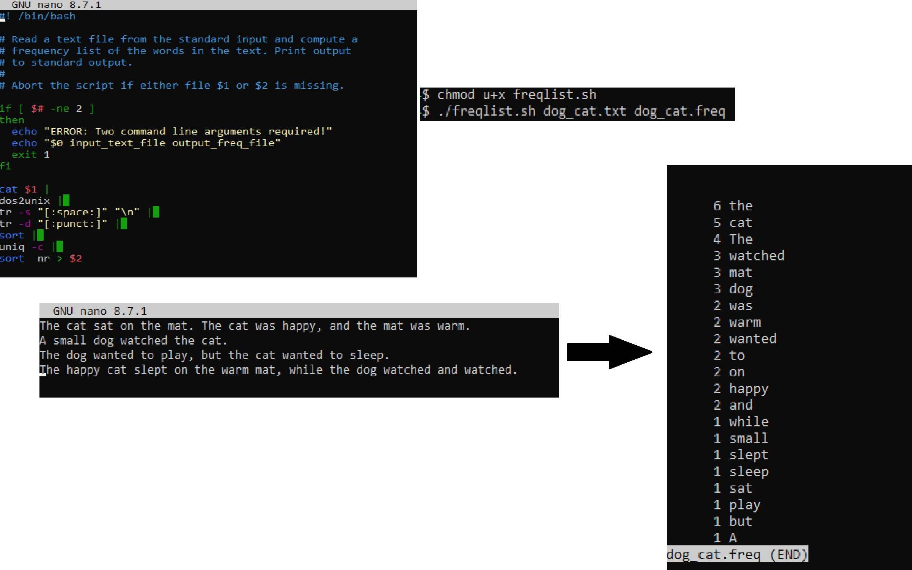

## Command Line Tools for Linguists

This course consisted of four modules and a final assignment that introduced the fundamentals of working in a Linux environment. Throughout the modules, I learned how to use command-line tools, process text, write basic scripts, install software, access remote servers, and manage projects using Git and GitHub. Together, these modules provided an introduction to essential command-line tools and development workflows.

### Module 1: Introduction to Command Line Environments

Introduction to the Linux command line using WSL Ubuntu. This module covered some basic commands for navigating directories, managing files, and editing text files.  
As a complete beginner to command line environments, this introductory module familiarized me with such essentials as:  
* `ls` - lists files and directories
* `cd` - changes the current directory
* `mkdir` - creates a new directory
* `less` - displays the contents of a text file

This was also the first time I ever used a Linux like environment in any capacity.

Example code:  
```
mkdir new_folder  
cd new_folder  
touch test.txt  
nano test.txt
```

The above code features basic commands for creating a new directory, changing that as the working directory and then creating an empty text file within that directory that is then opened with `nano`for editing.

### Module 2: Text Processing in UNIX

The second module offered an introduction to text processing in UNIX using tools such as grep, sed, sort, and uniq. Covered regular expressions, character encoding, and command pipelines.  
Personally, I found character encoding one of the trickest topics of the course. Changing my own environment's encoding to UTF-8 was quite a hassle. I had previous familiarity with regular expressions, but not so much with
combining those with grep or sed. After learning to use them I've found several use cases for the powerful tools in the search and consequent substitution of phrases.

Example code:  
`grep "English" languages.txt`  
A command that finds and prints lines containing the word "English" from the provided file.

`echo dog | sed s/dog/cat/`  
A `sed` command that takes the piped "dog" and substitutes the word "dog" with the word "cat" and prints it.

### Module 3: Scripting, Configuration Files and Installing Programs

This module covered basic scripting, conditional execution, and environment variables. Also introduced administrative privileges and installing software using package managers.  
As I'm most used to Python when it comes to programming, bash scripts weren't an entirely simple procedure to wrap my head around. Conditional execution itself was similar enough for the most part.
I found myself having to think very hard about input and output redirection. Unlike the previous module's pipelines, redirection, especially for input, is rather counterintuitive at times.



The above picture shows a bash script `freqlist.sh` that is given a text file as the first argument. It processes the text and provides a frequency list of the words in it, then writes that list into the output file
that is given to it as the second argument. Before the script is run it is transformed into an executable file by giving it user execute permissions with `chmod u+x`.


Example code:  
```
#!/bin/bash

name="Niisu"

if [ "$name" = "Niisu" ]; then
    echo "Hello, Niisu!"
else
    echo "Hello, stranger!"
fi
```

A bash script that takes a name as an argument and runs a conditional statement, outputting different results depending on the argument.

### Module 4: Using SSH, SCP and Version Control

The last module gave an introduction to remote server access, process management, and file transfers using SSH and SCP. Additionally it focused on version control and GitHub usage.  
I was very interested in finally getting to familiarize myself with GitHub. This module's simple introduction was valuable in establishing a foundation to work on in the final assignment.

Some of the most important Git commands and their purposes:

| Git command | Purpose                                    |
|-------------|--------------------------------------------|
| `git init`  | Initializes a repository                   |
| `git add`   | Adds files to staging area                 |
| `git commit`| Saves changes                              |
| `git status`| Shows repository status                    |
| `git push`  | Uploads changes to GitHub                  |
| `git pull`  | Downloads changes from a remote repository |


Example code:  
```
ls *.py &
ps -f
kill 7539
```


The first line of this code starts a background process that lists every file that has the .py extension at the end of its name.  
`ps` lists every running process, while the `-f` option provides additional information about each process, including the PID. Supposing there would be a process with the PID 7539, that process can then be stopped with the `kill`
command on the last line.

### Final Assignment: Building Webpages Using GitHub Pages

The assingment required us to build and publish a webpage using GitHub Pages, applying the GitHub and version control skills learned previously. Additionally, Jekyll, a site generator is used to turn Markdown files into a website.  
A very functionally useful end to the course overall, this assignment combined several of the skills learned during the past weeks.

Example code:  
```
git branch cmdline-course
git checkout cmdline-course
git add -A
git commit -m "Create a new branch and a new cmdline_course.md file"
git push -u origin cmdline-course
```

1. First line creates a new branch in the local repository.
2. `git checkout` switches to the specified branch.
3. All files and changes are added to the staging area.
4. The changes are saved along with a message detailing the changes.
5. Finally the whole new branch is pushed to GitHub.
