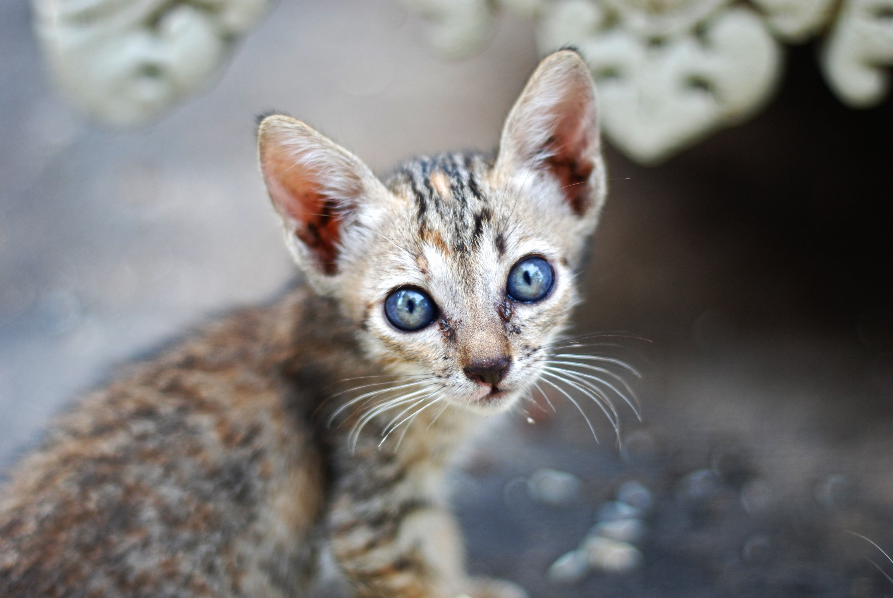

## Introduction

 My name is Niisu Heinikäinen. I study language technology at the University of Helsinki, as well as Japanese and general linguistics. I'm currently working on a bachelor's degree. In my spare time I like to game, read and write prose. My other passions include miniatures, travelling and watching videos of cats. A dream of mine is to one day publish a game of my own.

## Find me on

[GitHub](https://github.com/karusiiseli)

## Contact

My email address is of the form first_name.last_name@helsinki.fi. 

## Courses I've Taken

[Command Line Tools for Linguists](https://studies.helsinki.fi/kurssit/toteutus/hy-opt-cur-2627-261401a1-c550-4436-91b9-7edf4a1a3b57/KIK-LG221), fall 2026

[Machine Learning for Language Technology](https://studies.helsinki.fi/kurssit/toteutus/hy-opt-cur-2627-6baf2c75-648b-46ee-94e3-b8e47f50083f/LDA-T317), spring 2026

[Japani 2A](https://studies.helsinki.fi/kurssit/toteutus/hy-opt-cur-2627-e9668970-f814-43e5-b533-91fb895da619/KIK-JA213), fall 2026

[Yleisen kielitieteen ja fonetiikan johdantokurssi](https://studies.helsinki.fi/kurssit/toteutus/hy-opt-cur-2627-dd220e51-9ede-4297-974e-67604264e087/KIK-401), spring 2026

## Projects

[GitHub Project](https://github.com/Karusiiseli/cmdline-course)

The above is a small project meant as an introduction to using GitHub repositories.

## Misc. 

[Now I'm hungry](https://www.youtube.com/watch?v=OJj2F2kvx2M) 
